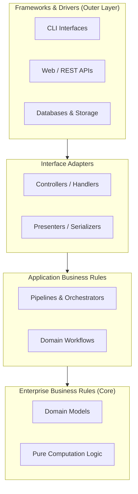

# 🏛️ System Architecture & Design Specification (ADR Blueprint)

> **Document Type:** Architecture Decision Record (ADR) & Design Blueprint  
> **Status:** Accepted (Clean Chassis Standard)  
> **Target:** Modular, maintainable, and high-performance software systems  

---

## 1. Architectural Philosophy

Clean Chassis enforces the **Clean Architecture** (Ports and Adapters) pattern, ensuring strict separation of concerns across concentric layers:



### Dependency Rule:
- Dependencies point **inward only**.
- Domain entities in `src/core/` have zero external dependencies on frameworks, databases, or UI layers.

---

## 2. Directory Structure Conventions

```text
src/
├── core/                  # Pure domain logic and calculations (Entities)
├── application/           # Workflow orchestration (Use Cases)
├── adapters/              # External integrations, APIs, and CLI controllers
└── common/                # General cross-cutting utilities (logging, metrics, seeds)
```

---

## 3. Architecture Decision Records (ADR Log)

### ADR-01: Two-Tier Quality Gates
- **Context:** Developers and AI coding agents can inadvertently introduce formatting inconsistencies, syntax errors, or failing tests.
- **Decision:** Implement local pre-commit hooks (Tier 1) for immediate feedback (< 1s) coupled with remote GitHub Actions (Tier 2) as non-bypassable merge blockers.
- **Consequences:** Near-zero regression rate; 100% CI compliance before code merges to `main`.

### ADR-02: Conventional Commits with Task Backlog Binding
- **Context:** Lack of traceability between code changes, task boards, and GitHub issues.
- **Decision:** Mandate commit message format `<type>(<scope>): [<TASK-ID>:#<NUM>] <desc>` enforced by `.githooks/commit-msg`.
- **Consequences:** Fully automated changelog generation, automatic issue linking, and clean git history.

### ADR-03: Headless Audit & Visual Summary Artifacts
- **Context:** Pull Request reviews require rapid visibility into test results and security posture.
- **Decision:** Generate `summary.md` and `artifacts/audit_summary.json` on every CI run, rendering markdown summaries in GitHub Step Summary and updating PR titles with live status badges.
